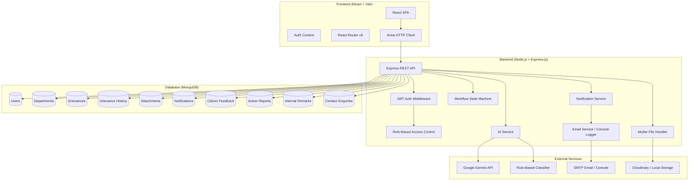

# System Architecture

## Overview

The CM Kerala Grievance Portal follows a standard 3-tier architecture: a React SPA frontend, an Express.js REST API backend, and a MongoDB database.

## Architecture Diagram



## Component Descriptions

### Frontend (React + Vite)
- **React Router v6**: Client-side routing with role-based route guards
- **AuthContext**: JWT token management, user state
- **Axios**: HTTP client with request/response interceptors
- **Tailwind CSS**: Utility-first styling with custom design system
- **Recharts**: Data visualisation for CMO dashboard

### Backend (Express.js)
- **Routes**: Modular Express routers (auth, public, grievances, cmo, officer, ai, attachments)
- **Middleware**: authenticate (JWT), requireRole (RBAC), validate (express-validator), upload (multer)
- **State Machine**: Enforces valid status transitions, rejects invalid ones with 409
- **AI Service**: LLM API call → zod validation → retry → fallback
- **Notifications**: In-app (MongoDB) + email (nodemailer / console logger)

### Database (MongoDB)
- **Mongoose ODM**: Schema definition, validation, pre-save hooks
- **Transactions**: Used for status changes and grievance creation
- **Indexes**: reference_id, status, district, department, citizen_id

## API Design

- **REST**: JSON request/response
- **Envelope**: `{ success: boolean, message: string, data: any }`
- **Auth**: Bearer token in `Authorization` header OR httpOnly `token` cookie
- **Pagination**: `?page=1&limit=10` → response includes `total, page, limit, totalPages`
- **HTTP Status Codes**: 200 OK, 201 Created, 400 Bad Request, 401 Unauthorized, 403 Forbidden, 404 Not Found, 409 Conflict, 500 Internal Server Error

## Security Architecture

| Concern | Implementation |
|---------|---------------|
| Authentication | JWT (HS256), 7-day expiry |
| Password storage | bcrypt, 12 salt rounds |
| Token transport | httpOnly cookie + Bearer header |
| Rate limiting | General: 200/15min; Auth: 20/15min; AI: 30/15min |
| CORS | Allowlist (CLIENT_URL env var) |
| Input validation | express-validator + zod |
| File security | MIME type check, size limit 5MB, path traversal protection |
| SQL injection | N/A (MongoDB + Mongoose parameterised queries) |
| XSS | React escapes by default; server uses helmet |
| RBAC | Server-side role check on every protected route |

## Deployment Architecture

```
Vercel (CDN) → React SPA (static)
                    ↓ HTTPS API calls
         Render.com → Express API Server
                    ↓ TLS connection
              MongoDB Atlas → Database
```
